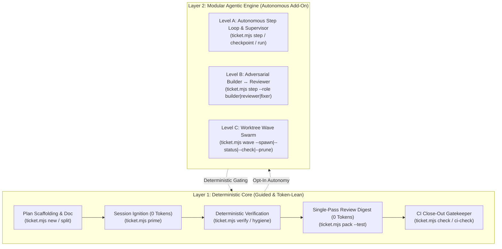

# AI-Dev-Workflow — Deterministic & Agentic Engineering Harness

A lightweight, **token-lean**, two-layer development and execution harness for **Claude Code**, **OpenAI Codex**, **Google Gemini / Antigravity**, and **Cursor**.

Designed for software engineers and high-velocity multi-agent coding on real-world token budgets—combining a **Deterministic Core** (plan discipline, verifiable acceptance criteria, single-pass code review, CI close-out gates) with an **Opt-In Modular Agentic Engine** (self-healing step execution loops, role-isolated adversarial reviews, parallel worktree waves) with **zero external npm dependencies** on Node.js 22+.

---

## Two-Layer Architecture



---

## Why This Exists

Most AI coding workflows fail in one of two ways:
1. **Too loose:** The agent jumps straight into code, forgets half the requirements, deletes failing checks, or ships unverified changes.
2. **Too bloated:** Heavy multi-agent pipelines, redundant sub-agent reviews, and 6-turn exploratory tool loops burn through token quotas on plans like Gemini Flash/Pro and ChatGPT Plus (Codex) before the real work is done.

`AI-Dev-Workflow` delivers the best of both worlds:
- **Layer 1 (Deterministic Core):** Enforces plan fidelity, verified criteria evidence, zero-token context ignition (`prime`), zero-token review digests (`pack`), and strict pre-push/CI gates.
- **Layer 2 (Modular Agentic Engine):** Enables autonomous self-healing loops with retry circuit breakers (`step` / `run`), verification-gated atomic git checkpoints (`checkpoint`), adversarial role briefs (`--role builder|reviewer|fixer`), and parallel git worktree waves (`wave`).
- **One canonical process in `AGENTS.md`** (loaded natively by Codex, Antigravity/Gemini, Cursor, and via `@AGENTS.md` in Claude Code).
- **One zero-dependency CLI (`scripts/ticket.mjs`)** with hermetic tests for plan scaffolding, session ignition, local or Notion ticket tracking, handoff logs, review packets, git guardrails, and GitHub Actions CI gates.
- **Zero-token session ignition (`ticket.mjs prime`)** that prints a compact ~20-line context primer for fresh agent chat sessions (active plan, branch, open criteria, next steps, tiered verify commands).
- **Zero-token review preparation (`ticket.mjs pack`)** that replaces 6+ exploratory tool calls with a single compact digest (plan criteria + working-tree hygiene + lockfile-filtered git diff + optional test verification proof via `--test`).
- **Instant context switching & worktrees (`ticket.mjs switch`)** to jump between main and isolated worktrees on-demand with automatic `.env` inheritance.
- **Automated plan splitting (`ticket.mjs split`)** to partition oversized plans into consecutive PR milestones without deleting checkboxes.
- **Tiered verification matrix & working-tree hygiene guardrails (`ticket.mjs verify`, `ticket.mjs hygiene`)** to detect unmerged conflicts, build debris, and oversized files before reviews and PR merges.
- **Drift-proof cross-machine portability (`scripts/sync.mjs --remote`)** to sync or check the workflow from GitHub anywhere with zero local folder dependencies.

---

## 60-Second Quickstart (Adopt in Any Repository)

Adopt the full token-lean AI development workflow into any git repository with a single command:

### macOS / Linux / WSL
```bash
curl -fsSL https://raw.githubusercontent.com/AaronPG095/AI-Dev-Workflow/main/scripts/install.sh | bash
# Or with a custom ticket prefix (e.g. FO):
curl -fsSL https://raw.githubusercontent.com/AaronPG095/AI-Dev-Workflow/main/scripts/install.sh | bash -s -- --prefix FO
```

### Windows (PowerShell)
```powershell
irm https://raw.githubusercontent.com/AaronPG095/AI-Dev-Workflow/main/scripts/install.ps1 | iex
# Or with a custom ticket prefix:
& (irm https://raw.githubusercontent.com/AaronPG095/AI-Dev-Workflow/main/scripts/install.ps1) -Prefix FO
```

**What the installer does automatically:**
1. Downloads the engine (`scripts/ticket.mjs`), test suite, sync tool, skills, and GitHub Actions workflows.
2. Generates a starter `scripts/ticket.config.json` in local tracker mode (ready to use immediately with zero API keys or external services).
3. Installs git pre-push guardrails (`.git/hooks/pre-push`) to prevent accidental pushes to protected branches.
4. Sets up agent skills for Claude Code (`.claude/skills/`), Antigravity/Gemini, Codex, and Cursor (`.agents/skills/`).

---

## The 6-Step Workflow

Trivial changes (`<= 40` changed lines, no new files in the main source folder, and no changes to managed workflow files) can skip the plan using the `no-plan` PR label. Workflow syncs require a plan. CI applies repository invariants even to trivial and archive-only changes. All non-trivial changes follow six steps:

1. **Plan** — Investigate read-only, propose the approach, and wait for human approval.
2. **Plan Doc** — Scaffold automatically with `node scripts/ticket.mjs new "<Topic>" [--type Feature] [--branch]` or copy `docs/plans/_template.plan.md` to `docs/plans/<PREFIX>-Plan-<Topic>-<YYYY-MM>.plan.md` with `- [ ]` checkboxes for Acceptance Criteria and Steps. Plans bigger than one PR are split into sequential plans via `node scripts/ticket.mjs split <plan> --after <#|query>`.
3. **Ticket (`create`)** — Run `node scripts/ticket.mjs create <plan> --agent <Claude|Codex|Gemini|Other>`. Supports **Local mode** (`local://<key>`, zero external setup) and **Notion mode** (deduplicated via `Dev Ticket Key`).
4. **Implement (`start`, `prime` & `log`)** — Branch, run `node scripts/ticket.mjs start`, and tick each checkbox as it is completed.
   - Switch or isolate worktrees on-demand with `node scripts/ticket.mjs switch [<plan|branch>]`.
   - Cold starts: run `node scripts/ticket.mjs prime` for an instant 20-line session primer, or `node scripts/ticket.mjs overview` for multi-repo status.
   - Every ticked acceptance criterion must end with concise `verified: <how and result>` evidence. Uncompleted items are never deleted—mark them `deferred: <reason>`.
   - When pausing or switching AI clients, run `node scripts/ticket.mjs handoff --agent <client> --done "<done>" --next "<step>" [--open "<questions>"]` (or `log`).
5. **Review (`pack` & `review`)** — Run `node scripts/ticket.mjs pack [--test]` (0 LLM tokens, embeds test results with `--test`) to produce a compact review packet.
   - Verify specific tiers with `node scripts/ticket.mjs verify [--tier <name>|--all]`.
   - Generate structured subagent prompts with `node scripts/ticket.mjs review --prompt`.
   - Run an **independent sub-agent, fresh-session, or second-model review** (`requireReview: true`, `allowSelfReview: false` by default) and stamp the result:
   ```powershell
   node scripts/ticket.mjs review --agent <client> --reviewer-id <subagent-id> --verdict <pass|warn|block> --summary "<findings>"
   # Or dual-pass review from a second model:
   node scripts/ticket.mjs review --agent <client> --standards pass --spec pass --summary "<findings>"
   ```
6. **Finish (`check`, `ship`, `merge`)** — Verify close-out and working-tree hygiene with `node scripts/ticket.mjs check [--strict]`, open the PR, and link it via `node scripts/ticket.mjs ship --pr <url>` (or run `node scripts/ticket.mjs pr [--verify] [--auto] [--draft]`). Once approved, run `node scripts/ticket.mjs merge [<plan>]` to merge via `gh pr merge` and close out the Notion Task locally with zero GitHub Actions minutes (or let `ticket-done.yml` close it on merge). `plan-check.yml` skips Draft PRs (`draft == false`, re-triggering on `ready_for_review`), skips redundant `ticket.test.mjs` CI runs when `ciSkipTicketTests: true` in the base config, and evaluates committed PR files with the base branch's validator.

Stage new files before preparing a review. The review records a fingerprint of the diff and plan requirements. Code or requirement edits require a new review. PR linking and progress log updates preserve the fingerprint. `requireReview` defaults to `true` and `allowSelfReview` defaults to `false` (require an independent `--agent` or `--reviewer-id <subagent-id>`). When adopting an older plan that lacks its implementing `agent`, restore the actual client in the plan before recording review.

Plan check verifies the recorded reviewer fields and the freshness of the review fingerprint. An independent sub-agent or fresh session can supply the review in a solo repository. The plan stamp records reviewer provenance as supplied by the reviewer.

`pr` requires a clean committed working tree. With `--verify`, it tests the initial commit and any new plan-link commit before pushing each revision. It stops if verification changes the checkout. If shipping fails after opening the PR, retry the command to reuse the open PR on that branch. The link commit contains only the selected plan.

Use `review --base <protected branch>` when the PR targets a secondary branch. The review records that base for subsequent `pack`, `check`, and `pr` runs. The `pr` command uses it on GitHub and rejects a reused PR with a different base. With `pr --retro` or `ship --retro`, the takeaway goes in the plan's progress log and preserves the code review. Use `lesson` for a shared entry in `docs/lessons.md`.

The `ticket-done.yml` workflow looks up the merged PR and all changed files through GitHub, so ticket closure covers merge commits, squash merges, and rebase merges. To retry in Actions, run **Close ticket on merge** from the default branch with the merged PR number. Set `"ci": { "ticketDoneWorkflow": false }` to disable automatic runs and keep this manual fallback. You can also retry with `ticket.mjs done <plan> --pr <url>` or `ticket.mjs ci-done --pr-number <number>`. A queued merge leaves the Task open until GitHub confirms the merge. Local mode derives closure from protected branch history.

Notion writes require the page to match the plan's Dev Ticket Key, Development lane, configured data source, project, and exact plan path recorded in the Task's Description. When renaming a plan or reconciling an older Task with missing provenance, update the original Task's Description with `Plan: <repo-relative plan path>` as its final line. Preserve the Dev Ticket Key and Notion URL. The automatic workflow runs trusted default-branch code with the merge contents read as data. For repositories with contributors who can dispatch workflows on their branches, scope the Notion secret to a protected GitHub environment and attach the close-out job to it.

Run `node scripts/ticket.mjs hook install` to block accidental direct pushes to protected branches and install the current hook. With `prePushVerify` configured, the hook requires a clean checkout of the commit being pushed. Push different commits separately. The hook checks the checkout again after verification.

---

## Repository Structure

```text
AI-Dev-Workflow/
├── .agents/skills/
│   ├── dev-workflow/SKILL.md      # Runnable 6-step checklist for agents
│   ├── quick-review/SKILL.md      # Single-pass, token-lean code review skill
│   └── agentic-workflow/SKILL.md  # Layer 2 modular agentic execution engine
├── .claude/skills/                # Mirror for Claude Code skill discovery
├── .github/
│   ├── workflows/
│   │   ├── ci.yml                 # Runs the test suite on push/PR
│   │   ├── plan-check.yml         # Blocks PRs with unclosed plans or unverified criteria
│   │   └── ticket-done.yml        # Closes Notion tickets from the full merged PR file list
│   └── pull_request_template.md
├── docs/
│   ├── decisions/                 # In-repo Architecture Decision Records (ADRs)
│   ├── dev-workflow/
│   │   └── setup-other-repos.md   # Guide for bootstrapping and syncing target repos
│   └── plans/
│       └── _template.plan.md      # Canonical plan template
├── scripts/
│   ├── hooks/
│   │   └── adw-hook.mjs           # Opt-in runtime hook handler (PreToolUse, PostToolUse, Stop)
│   ├── lib/
│   │   ├── markdown-plan.mjs      # Pure markdown & plan checkbox parser helpers
│   │   ├── invariants-lint.mjs    # Pure invariant, test-file, and diff-filter helpers
│   │   ├── stats-lessons.mjs      # Workflow lessons & escaped-defect stats helpers
│   │   └── symbols-map.mjs        # Zero-dep repo symbol outline & dependency token parser
│   ├── ticket.mjs                 # Zero-dependency workflow & review CLI (Node 22+)
│   ├── ticket.config.json         # Repository configuration (local mode default)
│   ├── ticket.test.mjs            # 101 hermetic unit and integration tests (node:test)
│   ├── workflow-manifest.json     # Versioned distribution manifest for sync & installers
│   ├── sync.mjs                   # Cross-platform sync and drift engine (--remote & local)
│   ├── sync-repos.ps1             # PowerShell wrapper for multi-repo sync
│   ├── install.ps1                # One-line Windows bootstrapper (irm | iex)
│   └── install.sh                 # One-line macOS/Linux/WSL bootstrapper (curl | bash)
├── AGENTS.md                      # Universal instructions for Codex, Gemini/Antigravity, Cursor
├── CLAUDE.md                      # @AGENTS.md import for Claude Code
└── ticket.config.example.json     # Example config for Local and Notion tracker modes
```

---

## CLI Reference (`scripts/ticket.mjs`)

Requires **Node.js 22+**. When `<plan>` is omitted on a feature branch, `ticket.mjs` automatically resolves the active plan for the current branch.

```powershell
# 1. Plan Scaffolding, Splitting & Ignition
# Optional for new projects / multi-PR initiatives: scaffold, list, or inspect child-plan rollup status of architecture blueprints in docs/architecture/
node scripts/ticket.mjs blueprint "Auth Architecture" [--version 1.2.0] [--force]
node scripts/ticket.mjs blueprint [list]
node scripts/ticket.mjs blueprint status [<blueprint-path>] [--json]

# Automatically creates docs/plans/<PREFIX>-Plan-<Topic>-<YYYY-MM>.plan.md (supports --type Feature|Bug|Refactor|Spike [--timebox 2h])
node scripts/ticket.mjs new "Smart Shortcut Suggestions" --type Feature [--appetite S|M|L] [--timebox 2h] [--version 1.2.0] [--impact none|patch|minor|major] [--blueprint docs/architecture/ADW-Blueprint-Auth-Architecture.md] [--depends-on "<plan-or-key>"] [--context "<findings>"] [--branch]

# List unblocked ready plans (dependencies satisfied) or atomically claim/release a plan for a worker
node scripts/ticket.mjs ready [--blueprint <path>] [--claim --agent <client>] [--release [<plan>]] [--json]

# Generate a zero-dependency repository symbol outline (exported functions, classes, and CLI commands with file:L<line> coordinates)
node scripts/ticket.mjs map [<path-or-filter>] [--max <N>] [--json]

# Fast one-command ignition: scaffold, set criteria, checkout branch, ticket, and start Doing
node scripts/ticket.mjs new "Fast Feature" --summary "..." --appetite M --version 1.2.0 --impact minor --criteria "c1|c2" --steps "s1|s2" --branch --create --start --agent Gemini

# Split an oversized plan into Part 1 and Part 2 without deleting checkboxes (defers moved items)
node scripts/ticket.mjs split docs/plans/ADW-Plan-Big-Feature.plan.md --after 3 [--title "Part 2 Title"]

# 2. Ticket Lifecycle
# Create ticket (Notion Task or local:// key)
node scripts/ticket.mjs create docs/plans/ADW-Plan-Example-2026-11.plan.md --agent Gemini

# Start work on a feature branch (records branch + worktree; optionally creates ticket if missing)
node scripts/ticket.mjs start [--create]

# 3. Agent Session Ignition, Worktree Switching & Handoff
# Prints a compact ~20-line context primer with numbered [1], [2] checkboxes (--verify runs fast/test baseline health check first)
node scripts/ticket.mjs prime [--verify]

# Instant context switching into an isolated worktree with .env setup (or return to main)
node scripts/ticket.mjs switch [<plan|branch>] [--path]
# Shell navigation alias helper:
cd $(node scripts/ticket.mjs switch <branch> --path)

# Tick checkboxes by index, comma-separated batch (1,2,3), --all-steps, or substring without editing markdown files
node scripts/ticket.mjs tick 1 --verified "tests pass"
node scripts/ticket.mjs tick 1,2,3 --verified "batch checks pass"
node scripts/ticket.mjs tick --all-steps
node scripts/ticket.mjs tick 1 --verify-cmd "npm test" [--evidence-type test|cmd|manual|inspect]
node scripts/ticket.mjs tick 1 --red "node --test scripts/failing.test.mjs"
node scripts/ticket.mjs defer 2 --reason "covered in follow-up"

# Record structured handoff between AI models (Gemini -> Claude -> Codex)
node scripts/ticket.mjs handoff --agent Gemini --done "Built parser" --next "Write tests" --open "none"

# Resume session with dirty tree check, optional baseline health check, and next pending action
node scripts/ticket.mjs resume [--verify]

# View active plans and branch status across all known repositories
node scripts/ticket.mjs overview

# 4. Review, Tiered Verification & Hygiene
# Run configured verification tiers (e.g. fast, test, full) or all tiers (--quiet prints 1-line summary on pass)
node scripts/ticket.mjs verify [--tier <name>|--all] [--quiet]

# Inspect working tree for disallowed artifacts (.tmp, test-results, coverage, *.log), oversized files, and dangling worktrees
node scripts/ticket.mjs hygiene

# Generate a 0-token review packet (includes Test Integrity check; --compact caps diff lines to 40/150); optionally embed test results
node scripts/ticket.mjs pack [--test] [--tier <name>] [--compact]

# Generate a structured review prompt for sub-agents or secondary models
node scripts/ticket.mjs review --prompt

# Record a single-pass or dual-pass independent review verdict (pass | warn | block)
# requireReview defaults to true and allowSelfReview defaults to false; pass --reviewer-id <id> for same-provider sub-agents; --model <id> records reviewModel; test drops require --allow-test-drop "<reason>"
node scripts/ticket.mjs review [--base <protected-branch>] --agent Codex [--model <model-id>] --verdict pass --summary "Criteria verified, clean hygiene"
node scripts/ticket.mjs review --agent Gemini --reviewer-id subagent-61f13605 --model gemini-4-neon-low --standards pass --spec pass --summary "Independent sub-agent dual-pass pass"

# 5. Finish & Gatekeeper
# Verify all checkboxes are closed, invariants pass, and working tree hygiene is clean (--strict also requires non-manual proof when verifyCommand is configured)
node scripts/ticket.mjs check [--strict]

# Lint a plan for placeholders, unresolved open questions, vague criteria, and uncovered AC# IDs (0 tokens)
node scripts/ticket.mjs lint [<plan>] [--strict] [--json]

# Automated PR creation and ticket shipping, with optional verification and retrospective
node scripts/ticket.mjs pr [--base <protected-branch>] [--verify] [--auto] [--draft] [--retro "<takeaway>"]

# Or link an already-opened PR manually:
node scripts/ticket.mjs ship --pr https://github.com/owner/repo/pull/1 [--retro "<takeaway>"]

# Merge PR via GitHub CLI and close the Notion Task locally (0 Actions minutes):
node scripts/ticket.mjs merge [<plan>] [--squash|--merge|--rebase] [--keep-branch] [--archive]
node scripts/ticket.mjs done [<plan>] [--pr <url>]

# Run configured verification tier (or pre-push check when prePushVerify is enabled):
node scripts/ticket.mjs verify [--tier fast|test|full] [--all] [--pre-push]
# The installed hook supplies --pushed-head <sha> to bind --pre-push to the outgoing commit.

# 6. Technical Memory, Metrics, Worktrees & Safety
# Scaffold in-repo Architecture Decision Record in docs/decisions/
node scripts/ticket.mjs adr "Use Native Child Process Over External Packages"

# Capture a reusable retrospective takeaway in docs/lessons.md (deduplicated; also auto-captured on Bug/Debug close-out and review block->pass; surfaced in recall & reviewer briefs)
node scripts/ticket.mjs lesson "<takeaway>" [--tags <a,b>] [--plan <path>]

# Instant keyword search across in-repo ADRs, architecture blueprints, dev-workflow docs, plan Notes, Progress logs, and docs/lessons.md
node scripts/ticket.mjs recall "Notion" [--lessons] [--fleet]

# Local workflow metrics (cycle time, review block/self-review rates, deferrals, retries, hunk/most-recent 14-day escaped defects)
node scripts/ticket.mjs stats [--fleet] [--days <N>] [--all-overlaps] [--compact] [--json]

# Safely archive completed or merged plans to docs/plans/archive/<YYYY-MM>/
node scripts/ticket.mjs archive [--all|--merged] [--fleet] [--dry-run]

# Isolated worktree lifecycle management with Windows extended-path cleanup
node scripts/ticket.mjs wt list [--fleet]
node scripts/ticket.mjs wt new [<plan>] [--name <dir>]
node scripts/ticket.mjs wt prune [--fleet] [--all] [--dry-run]

# Workspace and fleet diagnostic audit (drift, hooks, tracker tokens, worktrees, dirty state)
node scripts/ticket.mjs doctor [--fleet] [--compact]

# Unified Fleet Dashboard across all repositories (branches, dirty status, active plans, review verdicts)
node scripts/ticket.mjs fleet
node scripts/ticket.mjs fleet --pr
node scripts/ticket.mjs fleet --worktrees

# Run verification tiers across all repositories in the fleet with pass/fail summary
node scripts/ticket.mjs fleet verify [--tier <name>|--all]

# Execute command across all local repositories in parallel
node scripts/ticket.mjs exec "git status --short"

# Install, check, or remove the pre-push hook or opt-in AI client runtime hooks (.claude/settings.json -> scripts/hooks/adw-hook.mjs)
node scripts/ticket.mjs hook install
node scripts/ticket.mjs hook [install|uninstall|status] [--agent-hooks] [--fleet]

# 7. Layer 2: Modular Agentic Coding Engine (Levels A, B, C)
# Level A: Get the next unticked step, verify command, and retry budget
node scripts/ticket.mjs step
node scripts/ticket.mjs step --json

# Level A: Stage the intended changes, then verify and commit them with the plan
node scripts/ticket.mjs checkpoint <#> --commit [--message "<msg>"] [--tier <name>]

# Outer-Loop Autonomous Supervisor (drive an external CLI runner step-by-step up to maxRetries; exports ADW_MODEL for the active role)
node scripts/ticket.mjs run [<plan>] --cmd "<runner>" [--review-cmd "<runner>"] [--commit] [--tier <name>] [--max-retries <N>] [--max-steps <N>] [--no-review] [--dry-run]

# Level B: Generate role-isolated sub-agent briefs (Planner, Builder, Adversarial Reviewer, Block-Fixer)
node scripts/ticket.mjs step --role planner
node scripts/ticket.mjs step --role builder
node scripts/ticket.mjs step --role reviewer
node scripts/ticket.mjs step --role fixer

# Level C: Parallel Worktree Wave Swarm (provision, monitor, check, and prune isolated worktrees)
node scripts/ticket.mjs wave --spawn [--dry-run]
node scripts/ticket.mjs wave docs/plans/Plan-A.plan.md docs/plans/Plan-B.plan.md --spawn
node scripts/ticket.mjs wave --status
node scripts/ticket.mjs wave --check [--test] [--strict]
node scripts/ticket.mjs wave --prune [--dry-run] [--all]

# 8. Versioning & Release Train Management (Opt-In)
# Inspect release train status across active + archived plans (shipped, ready, in-progress, planned) and docs/ROADMAP.md
node scripts/ticket.mjs release [status] [<version>] [--json] [--all]

# Generate Keep-a-Changelog Markdown section from closed-out plans targeting <version> (--all includes open plans; --write updates CHANGELOG.md)
node scripts/ticket.mjs release notes [<version>] [--write] [--all]

# Scaffold a release closeout plan for <version>
node scripts/ticket.mjs release closeout <version> [--branch]

# Initialize a canonical single-file docs/ROADMAP.md
node scripts/ticket.mjs release init [--force]

# Run the hermetic test suite
node --test scripts/ticket.test.mjs
```

Wave uses Git's registered worktrees. A worker owns its plan after creation, and rerunning spawn preserves its progress. Dry runs leave the repository and worktrees untouched. Prune considers clean, unlocked, inactive worktrees under the primary checkout's `.worktrees` directory.

### Runtime Hooks, Boot Verification & Versioning Config (`scripts/ticket.config.json`)
- `bootVerifyTier`: Verification tier executed by `prime --verify` and `resume --verify` (defaults to `fast`, falling back to `test` or `full`).
- `agentic.models`: Optional role-to-model routing map (`planner`, `builder`, `fixer`, `reviewer`; defaults to `gemini-4-neon-medium`, `gemini-4-hydrogen-medium`, `gemini-4-hydrogen-medium`, `gemini-4-neon-low`). Surfaced by `step`, `prime`, `review --prompt`, and `run` (`ADW_MODEL` env var). In Antigravity, delegate each role to a `swarm` worker pinned to its configured `model`; other clients (Claude Code, Codex, Cursor) can customize or omit `agentic.models`.
- `hooks.postToolVerify`: Set `true` in `ticket.config.json` to run bounded `fast`/`test` verification after edit tools in `scripts/hooks/adw-hook.mjs post-tool`.
- `hooks.postToolStrict`: Set `true` to exit `2` (blocking) when `post-tool` verification fails instead of warning cleanly.
- `versioning`: Opt-in release train management (`enabled`, `currentVersion`, `activeTrain`, `roadmapPath` default `docs/ROADMAP.md`, `changelogPath` default `CHANGELOG.md`, `tagPrefix` default `v`, `requireVersionOnPlans`). When `version` is set on a plan, `create` stamps `Target Version` on the Notion Task.


---

## Cross-Machine Syncing & Downstream Repositories

### Remote Sync (Any Machine, Zero Local Sibling Dependencies)
In any target repository clone anywhere in the world, sync directly from GitHub:

```powershell
# Check for drift against upstream
node scripts/sync.mjs --remote --check

# Pull latest CLI, skills, plan template, and workflows
node scripts/sync.mjs --remote
```

### Local Multi-Repo Batch Sync
When developing locally with sibling repositories in the same parent folder:

```powershell
# Check drift across all configured repositories
.\scripts\sync-repos.ps1 -AllKnown -Check

# Sync latest workflow files across all repositories
.\scripts\sync-repos.ps1 -AllKnown
node scripts/sync.mjs --all-known [--ensure-invariants] [--ensure-ignore]

# Bootstrap a brand-new repository with starter config
.\scripts\sync-repos.ps1 C:\path\to\my-repo -InitPrefix MYP
```

Both installers and `sync.mjs` use the same versioned manifest. Remote sync resolves its ref to one Git commit before loading files. Use `--branch <commit-sha>` for an exact release. Existing `scripts/ticket.config.json` files are preserved. To upgrade an older copy without the manifest, run the current installer from GitHub in the target repo.

`--check` exits with **0** when current, **1** for managed-file drift or absence, and **2** for an incomplete check such as missing config or a failed download. `--check --bundle-only` checks the manifest-managed files without checking generated agent documentation. Doctor uses this mode against the local bundle.

See [`docs/dev-workflow/setup-other-repos.md`](docs/dev-workflow/setup-other-repos.md) for full details on Local vs. Notion configuration.
