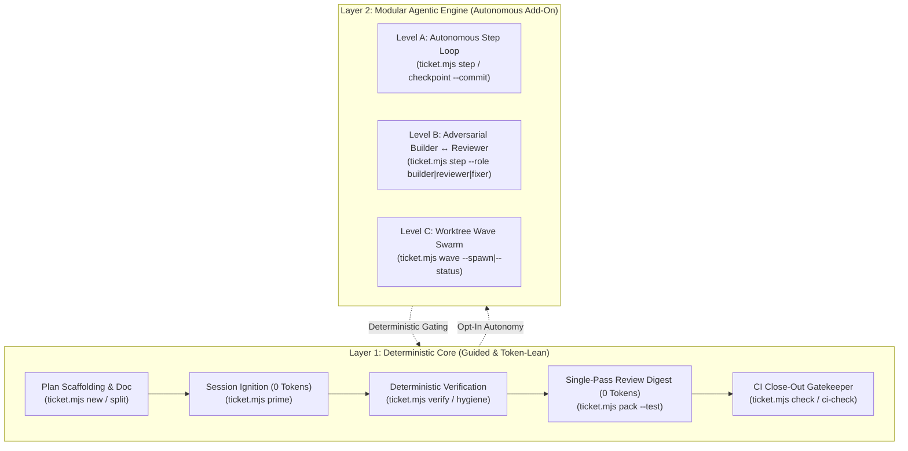

# AI-Dev-Workflow — Deterministic & Agentic Engineering Harness

A lightweight, **token-lean**, two-layer development and execution harness for **Claude Code**, **OpenAI Codex**, **Google Gemini / Antigravity**, and **Cursor**.

Designed for software engineers and high-velocity multi-agent coding on real-world token budgets—combining a **Deterministic Core** (plan discipline, verifiable acceptance criteria, single-pass code review, CI close-out gates) with an **Opt-In Modular Agentic Engine** (self-healing step execution loops, role-isolated adversarial reviews, parallel worktree waves) with **zero external npm dependencies** on Node.js 22+.

---

## Two-Layer Architecture



---

## Why This Exists

Most AI coding workflows fail in one of two ways:
1. **Too loose:** The agent jumps straight into code, forgets half the requirements, deletes failing checks, or ships unverified changes.
2. **Too bloated:** Heavy multi-agent pipelines, redundant sub-agent reviews, and 6-turn exploratory tool loops burn through token quotas on plans like Gemini Flash/Pro and ChatGPT Plus (Codex) before the real work is done.

`AI-Dev-Workflow` delivers the best of both worlds:
- **Layer 1 (Deterministic Core):** Enforces plan fidelity, verified criteria evidence, zero-token context ignition (`prime`), zero-token review digests (`pack`), and strict pre-push/CI gates.
- **Layer 2 (Modular Agentic Engine):** Enables autonomous self-healing loops with retry circuit breakers (`step`), verification-gated atomic git checkpoints (`checkpoint`), adversarial role briefs (`--role builder|reviewer|fixer`), and parallel git worktree waves (`wave`).
- **One canonical process in `AGENTS.md`** (loaded natively by Codex, Antigravity/Gemini, Cursor, and via `@AGENTS.md` in Claude Code).
- **One zero-dependency CLI (`scripts/ticket.mjs`)** with 57 hermetic tests running across macOS, Linux, and Windows.
- **One zero-dependency CLI (`scripts/ticket.mjs`)** for plan scaffolding, session ignition, local or Notion ticket tracking, handoff logs, deterministic review packets, git guardrails, and GitHub Actions CI gates.
- **Zero-token session ignition (`ticket.mjs prime`)** that prints a compact ~20-line context primer for fresh agent chat sessions (active plan, branch, open criteria, next steps, tiered verify commands).
- **Zero-token review preparation (`ticket.mjs pack`)** that replaces 6+ exploratory tool calls with a single compact digest (plan criteria + working-tree hygiene + lockfile-filtered git diff + optional test verification proof via `--test`).
- **Instant context switching & worktrees (`ticket.mjs switch`)** to jump between main and isolated worktrees on-demand with automatic `.env` inheritance.
- **Automated plan splitting (`ticket.mjs split`)** to partition oversized plans into consecutive PR milestones without deleting checkboxes.
- **Tiered verification matrix & working-tree hygiene guardrails (`ticket.mjs verify`, `ticket.mjs hygiene`)** to detect unmerged conflicts, build debris, and oversized files before reviews and PR merges.
- **Drift-proof cross-machine portability (`scripts/sync.mjs --remote`)** to sync or check the workflow from GitHub anywhere with zero local folder dependencies.

---

## 60-Second Quickstart (Adopt in Any Repository)

Adopt the full token-lean AI development workflow into any git repository with a single command:

### macOS / Linux / WSL
```bash
curl -fsSL https://raw.githubusercontent.com/AaronPG095/AI-Dev-Workflow/main/scripts/install.sh | bash
# Or with a custom ticket prefix (e.g. FO):
curl -fsSL https://raw.githubusercontent.com/AaronPG095/AI-Dev-Workflow/main/scripts/install.sh | bash -s -- --prefix FO
```

### Windows (PowerShell)
```powershell
irm https://raw.githubusercontent.com/AaronPG095/AI-Dev-Workflow/main/scripts/install.ps1 | iex
# Or with a custom ticket prefix:
& (irm https://raw.githubusercontent.com/AaronPG095/AI-Dev-Workflow/main/scripts/install.ps1) -Prefix FO
```

**What the installer does automatically:**
1. Downloads the engine (`scripts/ticket.mjs`), test suite, sync tool, skills, and GitHub Actions workflows.
2. Generates a starter `scripts/ticket.config.json` in local tracker mode (ready to use immediately with zero API keys or external services).
3. Installs git pre-push guardrails (`.git/hooks/pre-push`) to prevent accidental pushes to protected branches.
4. Sets up agent skills for Claude Code (`.claude/skills/`), Antigravity/Gemini, Codex, and Cursor (`.agents/skills/`).

---

## The 6-Step Workflow

Trivial changes (`<= 40` changed lines, no new files in the main source folder, and no changes to managed workflow files) can skip the process using the `no-plan` PR label. Workflow sync PRs need a plan until the updater can verify the upstream version. All non-trivial changes follow six steps:

1. **Plan** — Investigate read-only, propose the approach, and wait for human approval.
2. **Plan Doc** — Scaffold automatically with `node scripts/ticket.mjs new "<Topic>" [--type Feature] [--branch]` or copy `docs/plans/_template.plan.md` to `docs/plans/<PREFIX>-Plan-<Topic>-<YYYY-MM>.plan.md` with `- [ ]` checkboxes for Acceptance Criteria and Steps. Plans bigger than one PR are split into sequential plans via `node scripts/ticket.mjs split <plan> --after <#|query>`.
3. **Ticket (`create`)** — Run `node scripts/ticket.mjs create <plan> --agent <Claude|Codex|Gemini|Other>`. Supports **Local mode** (`local://<key>`, zero external setup) and **Notion mode** (deduplicated via `Dev Ticket Key`).
4. **Implement (`start`, `prime` & `log`)** — Branch, run `node scripts/ticket.mjs start`, and tick each checkbox as it is completed.
   - Switch or isolate worktrees on-demand with `node scripts/ticket.mjs switch [<plan|branch>]`.
   - Cold starts: run `node scripts/ticket.mjs prime` for an instant 20-line session primer, or `node scripts/ticket.mjs overview` for multi-repo status.
   - Every ticked acceptance criterion must end with concise `verified: <how and result>` evidence. Uncompleted items are never deleted—mark them `deferred: <reason>`.
   - When pausing or switching AI clients, run `node scripts/ticket.mjs handoff --agent <client> --done "<done>" --next "<step>" [--open "<questions>"]` (or `log`).
5. **Review (`pack` & `review`)** — Run `node scripts/ticket.mjs pack [--test]` (0 LLM tokens, embeds test results with `--test`) to produce a compact review packet.
   - Verify specific tiers with `node scripts/ticket.mjs verify [--tier <name>|--all]`.
   - Generate structured subagent prompts with `node scripts/ticket.mjs review --prompt`.
   - Run a single-pass or dual-pass review (via `quick-review`, fresh session, or second AI) and stamp the result:
   ```powershell
   node scripts/ticket.mjs review --agent <client> --verdict <pass|warn|block> --summary "<findings>"
   # Or dual-pass review:
   node scripts/ticket.mjs review --agent <client> --standards pass --spec pass --summary "<findings>"
   ```
6. **Finish (`check` & `ship`)** — Verify close-out and working-tree hygiene with `node scripts/ticket.mjs check [--strict]`, open the PR, and link it via `node scripts/ticket.mjs ship --pr <url>` (or run `node scripts/ticket.mjs pr [--verify] [--auto]`). GitHub Actions evaluates committed PR files with the base branch's validator. It rejects reused closed plans, removed or replaced checkboxes, empty evidence, committed artifacts matching the hygiene patterns, and a `block` or stale review verdict.

Stage new files before preparing a review. The review records a fingerprint of the diff and plan requirements. Code or requirement edits require a new review. PR linking and progress log updates preserve the fingerprint. Set `requireReview: true` to require a passing or warning review before close-out.

*(Optional safety guardrail: run `node scripts/ticket.mjs hook install` to block accidental direct pushes to protected branches like `main`.)*

---

## Repository Structure

```text
AI-Dev-Workflow/
├── .agents/skills/
│   ├── dev-workflow/SKILL.md      # Runnable 6-step checklist for agents
│   ├── quick-review/SKILL.md      # Single-pass, token-lean code review skill
│   └── agentic-workflow/SKILL.md  # Layer 2 modular agentic execution engine
├── .claude/skills/                # Mirror for Claude Code skill discovery
├── .github/
│   ├── workflows/
│   │   ├── ci.yml                 # Runs the test suite on push/PR
│   │   ├── plan-check.yml         # Blocks PRs with unclosed plans or unverified criteria
│   │   ├── ticket-done.yml        # Marks linked tickets Done when a PR merges
│   │   └── workflow-sync.yml      # Weekly automated drift check and sync PR generator
│   └── pull_request_template.md
├── docs/
│   ├── decisions/                 # In-repo Architecture Decision Records (ADRs)
│   ├── dev-workflow/
│   │   └── setup-other-repos.md   # Guide for bootstrapping and syncing target repos
│   └── plans/
│       └── _template.plan.md      # Canonical plan template
├── scripts/
│   ├── ticket.mjs                 # Zero-dependency workflow & review CLI (Node 22+)
│   ├── ticket.config.json         # Repository configuration (local mode default)
│   ├── ticket.test.mjs            # 57 hermetic unit & integration tests (node:test)
│   ├── sync.mjs                   # Cross-platform sync and drift engine (--remote & local)
│   ├── sync-repos.ps1             # PowerShell wrapper for multi-repo sync
│   └── install.ps1                # One-line multi-machine bootstrapper (curl/iex)
├── AGENTS.md                      # Universal instructions for Codex, Gemini/Antigravity, Cursor
├── CLAUDE.md                      # @AGENTS.md import for Claude Code
└── ticket.config.example.json     # Example config for Local and Notion tracker modes
```

---

## CLI Reference (`scripts/ticket.mjs`)

Requires **Node.js 22+**. When `<plan>` is omitted on a feature branch, `ticket.mjs` automatically resolves the active plan for the current branch.

```powershell
# 1. Plan Scaffolding, Splitting & Ignition
# Automatically creates docs/plans/<PREFIX>-Plan-<Topic>-<YYYY-MM>.plan.md
node scripts/ticket.mjs new "Smart Shortcut Suggestions" --type Feature [--branch]

# Fast one-command ignition: scaffold, set criteria, checkout branch, ticket, and start Doing
node scripts/ticket.mjs new "Fast Feature" --summary "..." --criteria "c1|c2" --steps "s1|s2" --branch --create --start --agent Gemini

# Split an oversized plan into Part 1 and Part 2 without deleting checkboxes (defers moved items)
node scripts/ticket.mjs split docs/plans/ADW-Plan-Big-Feature.plan.md --after 3 [--title "Part 2 Title"]

# 2. Ticket Lifecycle
# Create ticket (Notion Task or local:// key)
node scripts/ticket.mjs create docs/plans/ADW-Plan-Example-2026-11.plan.md --agent Gemini

# Start work on a feature branch (records branch + worktree; optionally creates ticket if missing)
node scripts/ticket.mjs start [--create]

# 3. Agent Session Ignition, Worktree Switching & Handoff
# Prints a compact ~20-line context primer with numbered [1], [2] checkboxes for fresh chat sessions
node scripts/ticket.mjs prime

# Instant context switching into an isolated worktree with .env setup (or return to main)
node scripts/ticket.mjs switch [<plan|branch>] [--path]
# Shell navigation alias helper:
cd $(node scripts/ticket.mjs switch <branch> --path)

# Tick checkboxes by index or substring without editing markdown files (enforces --verified on criteria)
node scripts/ticket.mjs tick 1 --verified "tests pass"
node scripts/ticket.mjs defer 2 --reason "covered in follow-up"

# Record structured handoff between AI models (Gemini -> Claude -> Codex)
node scripts/ticket.mjs handoff --agent Gemini --done "Built parser" --next "Write tests" --open "none"

# Resume session with dirty tree check and next pending action
node scripts/ticket.mjs resume

# View active plans and branch status across all known repositories
node scripts/ticket.mjs overview

# 4. Review, Tiered Verification & Hygiene
# Run configured verification tiers (e.g. fast, test, full) or all tiers
node scripts/ticket.mjs verify [--tier <name>|--all]

# Inspect working tree for disallowed artifacts (.tmp, test-results, coverage, *.log), oversized files, and dangling worktrees
node scripts/ticket.mjs hygiene

# Generate a 0-token review packet; optionally embed test results for a specific tier
node scripts/ticket.mjs pack [--test] [--tier <name>]

# Generate a structured review prompt for sub-agents or secondary models
node scripts/ticket.mjs review --prompt

# Record a single-pass or dual-pass code review verdict (pass | warn | block)
node scripts/ticket.mjs review --agent Codex --verdict pass --summary "Criteria verified, clean hygiene"
node scripts/ticket.mjs review --agent Gemini --standards pass --spec pass --summary "Dual-pass pass"

# 5. Finish & Gatekeeper
# Verify all checkboxes are closed and working tree hygiene is clean (--strict to fail on warnings)
node scripts/ticket.mjs check [--strict]

# Automated PR creation & ticket shipping in one command (pushes branch, verifies, opens PR, auto-merges)
node scripts/ticket.mjs pr [--verify] [--auto] [--draft]

# Or link an already-opened PR manually:
node scripts/ticket.mjs ship --pr https://github.com/owner/repo/pull/1

# 6. Technical Memory, Worktrees, Diagnostics & Safety
# Scaffold in-repo Architecture Decision Record in docs/decisions/
node scripts/ticket.mjs adr "Use Native Child Process Over External Packages"

# Instant keyword search across in-repo ADRs, plan Notes, and Progress logs
node scripts/ticket.mjs recall "Notion" [--fleet]

# Safely archive completed plans to docs/plans/archive/<YYYY-MM>/
node scripts/ticket.mjs archive [--all]

# Isolated worktree lifecycle management with Windows extended-path cleanup
node scripts/ticket.mjs wt list [--fleet]
node scripts/ticket.mjs wt new [<plan>] [--name <dir>]
node scripts/ticket.mjs wt prune [--fleet] [--all] [--dry-run]

# Workspace and fleet diagnostic audit (drift, hooks, tracker tokens, worktrees, dirty state)
node scripts/ticket.mjs doctor [--fleet]

# Unified Fleet Dashboard across all repositories (branches, dirty status, active plans, review verdicts)
node scripts/ticket.mjs fleet
node scripts/ticket.mjs fleet --pr
node scripts/ticket.mjs fleet --worktrees

# Run verification tiers across all repositories in the fleet with pass/fail summary
node scripts/ticket.mjs fleet verify [--tier <name>|--all]

# Execute command across all local repositories in parallel
node scripts/ticket.mjs exec "git status --short"

# Install pure shell pre-push hook to prevent direct push to protected branches
node scripts/ticket.mjs hook install

# 7. Layer 2: Modular Agentic Coding Engine (Levels A, B, C)
# Level A: Get the next unticked step, verify command, and retry budget
node scripts/ticket.mjs step
node scripts/ticket.mjs step --json

# Level A: Stage the intended changes, then verify and commit them with the plan
node scripts/ticket.mjs checkpoint <#> --commit [--message "<msg>"] [--tier <name>]

# Level B: Generate role-isolated sub-agent briefs (Builder, Adversarial Reviewer, Block-Fixer)
node scripts/ticket.mjs step --role builder
node scripts/ticket.mjs step --role reviewer
node scripts/ticket.mjs step --role fixer

# Level C: Parallel Worktree Wave Swarm (provision isolated worktrees & live dashboard)
node scripts/ticket.mjs wave --spawn
node scripts/ticket.mjs wave docs/plans/Plan-A.plan.md docs/plans/Plan-B.plan.md --spawn
node scripts/ticket.mjs wave --status

# Run the 57-test hermetic test suite
node --test scripts/ticket.test.mjs
```

---

## Cross-Machine Syncing & Downstream Repositories

### Remote Sync (Any Machine, Zero Local Sibling Dependencies)
In any target repository clone anywhere in the world, sync directly from GitHub:

```powershell
# Check for drift against upstream
node scripts/sync.mjs --remote --check

# Pull latest CLI, skills, plan template, and workflows
node scripts/sync.mjs --remote
```

### Local Multi-Repo Batch Sync
When developing locally with sibling repositories in the same parent folder:

```powershell
# Check drift across all configured repositories
.\scripts\sync-repos.ps1 -AllKnown -Check

# Sync latest workflow files across all repositories
.\scripts\sync-repos.ps1 -AllKnown

# Bootstrap a brand-new repository with starter config
.\scripts\sync-repos.ps1 C:\path\to\my-repo -InitPrefix MYP
```

### Automated GitHub Action Sync (`workflow-sync.yml`)
Downstream repositories receive `.github/workflows/workflow-sync.yml`, which runs weekly or via `workflow_dispatch`. If upstream `AI-Dev-Workflow` has updates, the action automatically detects drift and opens a PR: `chore(workflow): sync to latest AI-Dev-Workflow`.

See [`docs/dev-workflow/setup-other-repos.md`](docs/dev-workflow/setup-other-repos.md) for full details on Local vs. Notion configuration.
